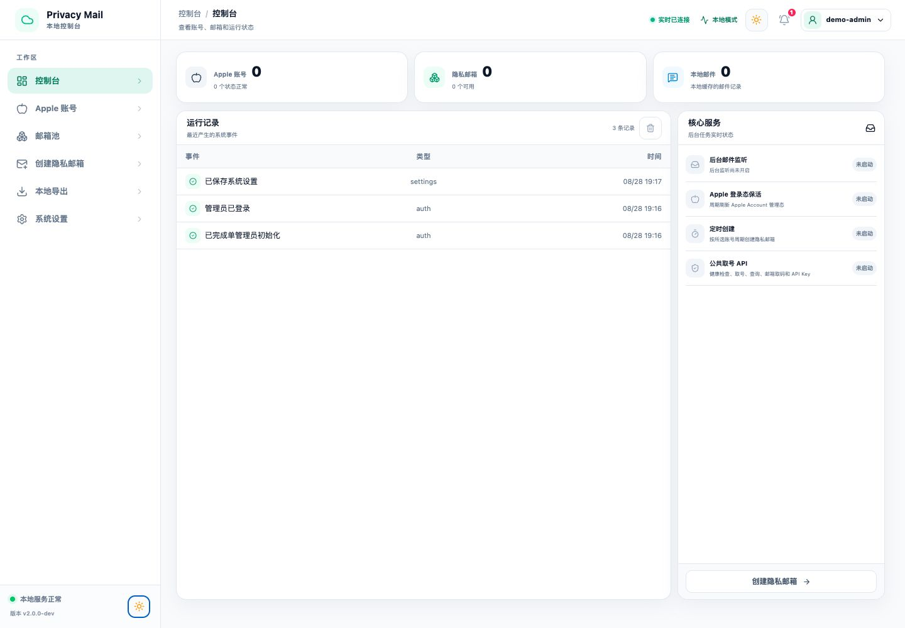
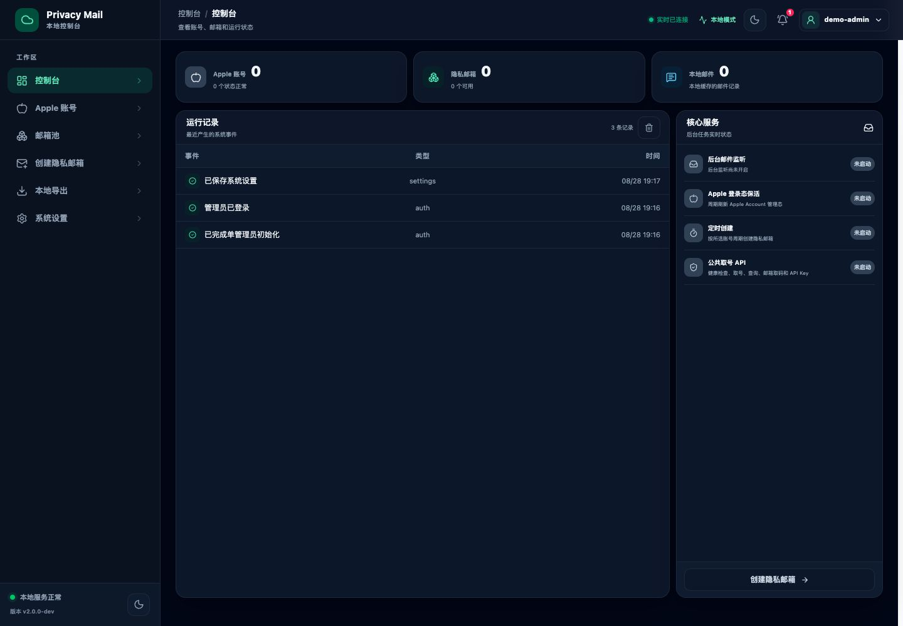
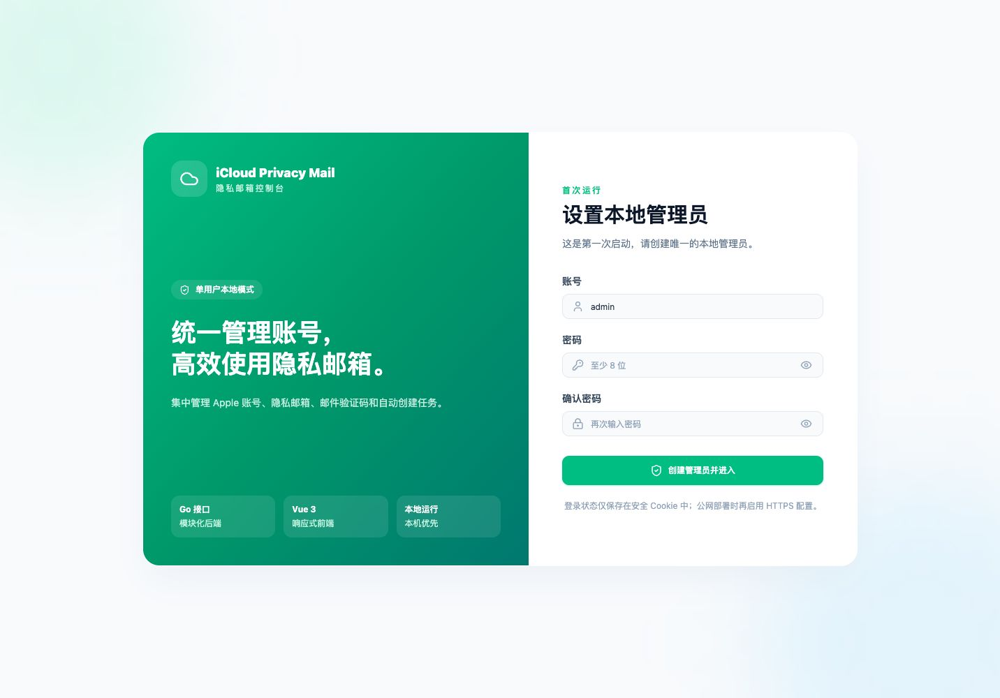
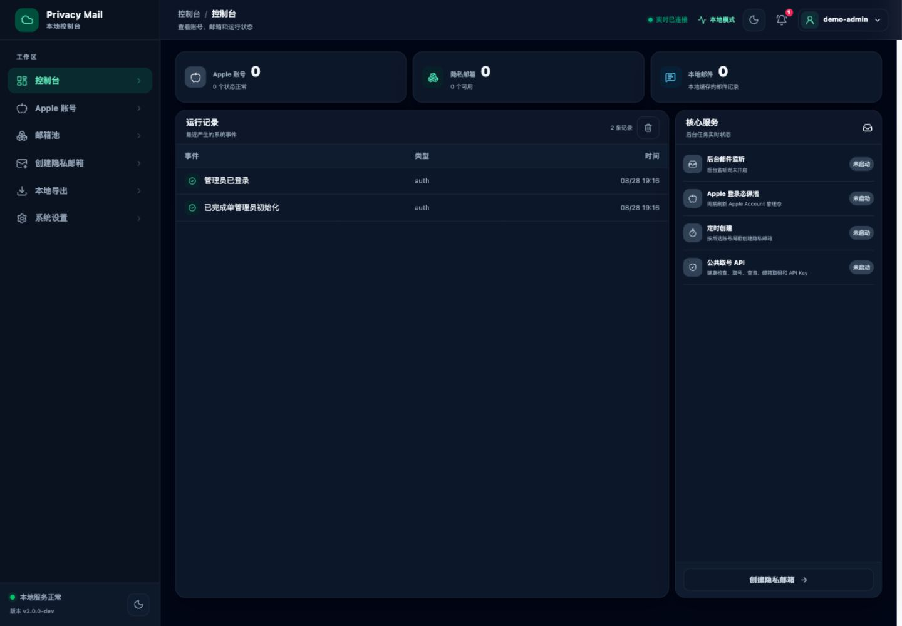
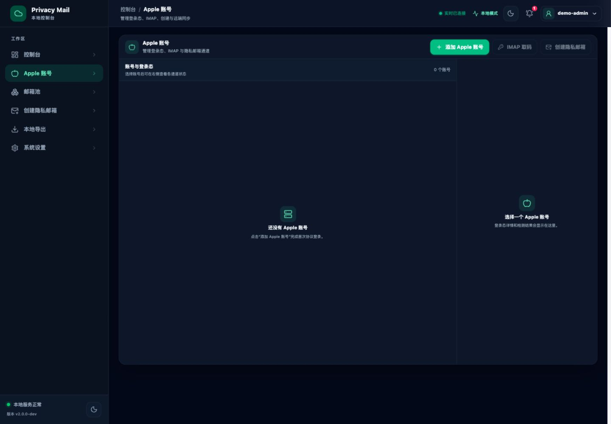
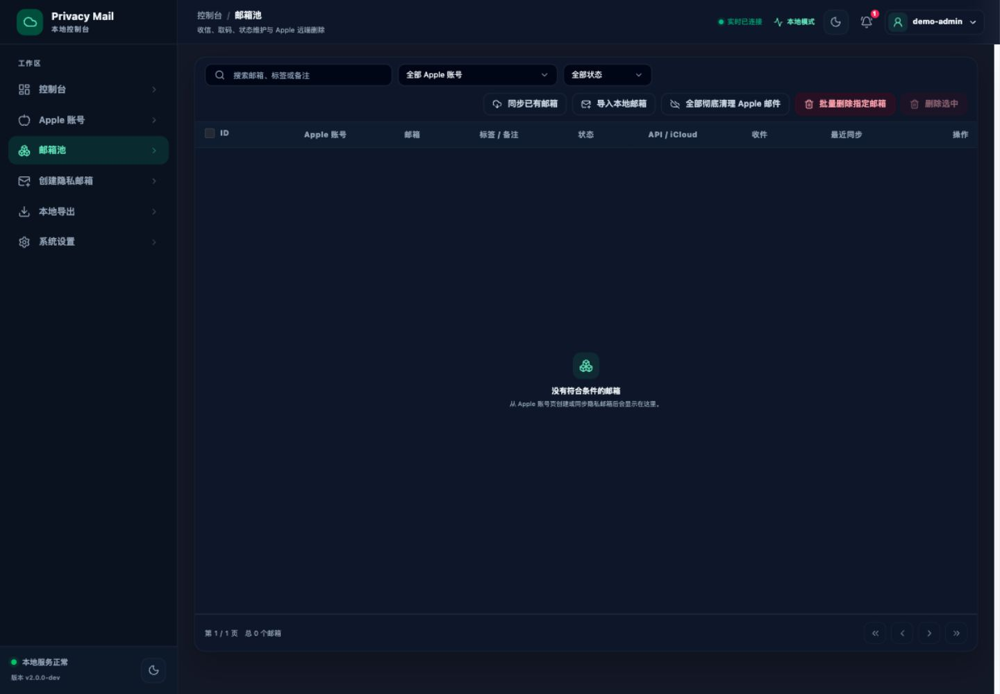
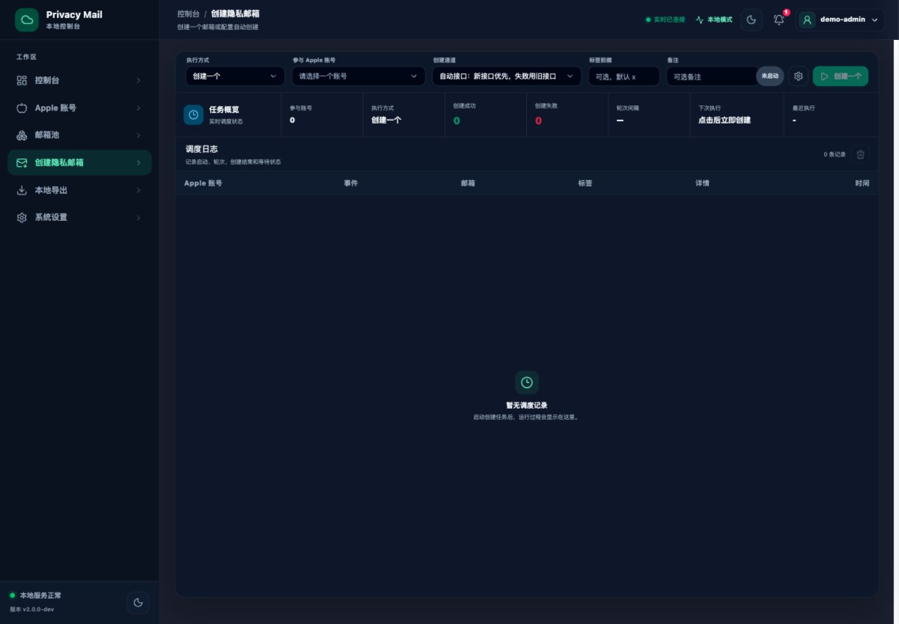
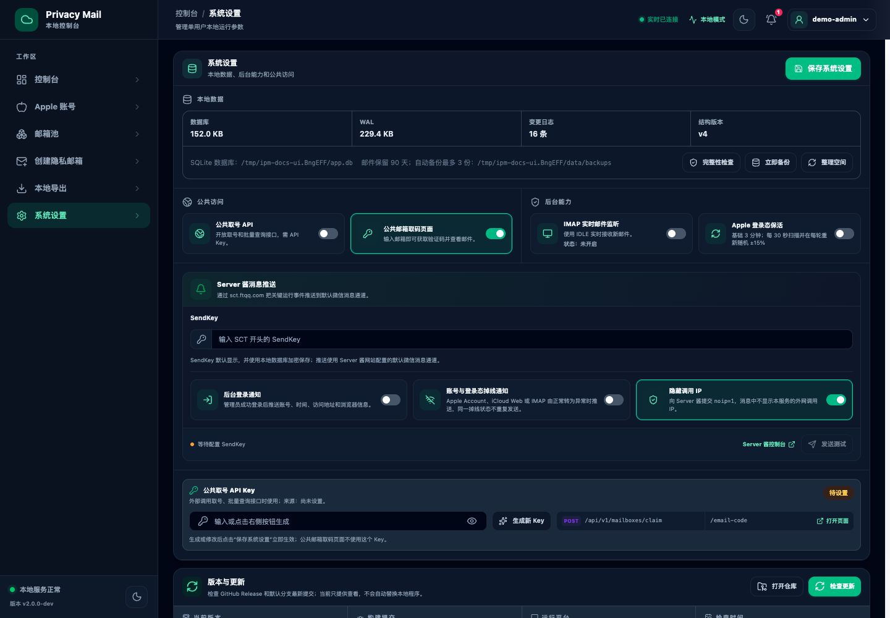
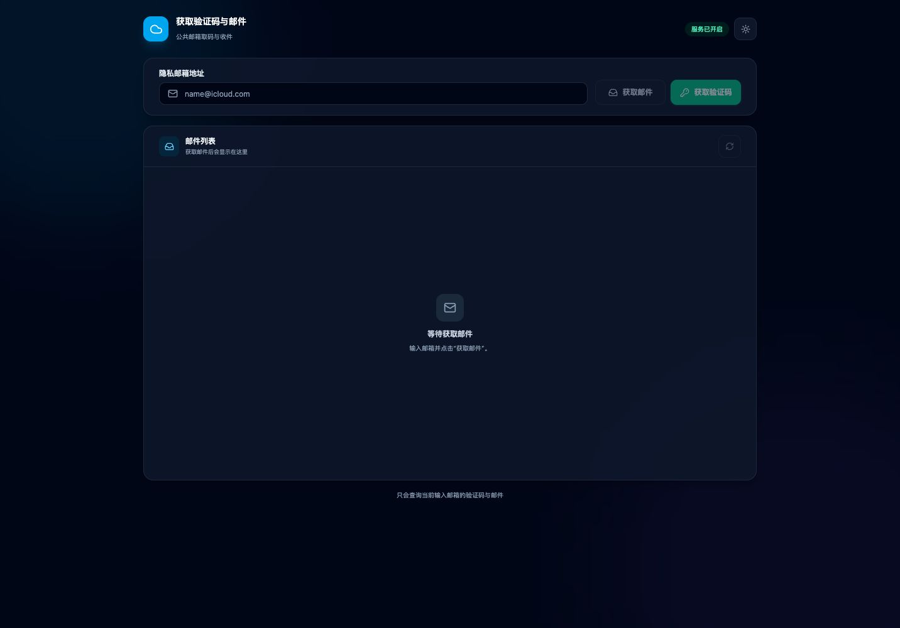

# MailBasin

本地运行的邮箱池管理工具：把 Apple、微软、Google 与自有 IMAP 邮箱集中接入，统一收信、取验证码、批量创建与清理。后端使用 Go，前端使用 Vue 3，账号、邮箱、邮件、任务和系统设置统一保存在 SQLite。

## 环境要求

- Go 1.25 或更高版本
- Node.js 20.19+ 或 22.12+
- npm

## 快速启动

首次运行先复制配置文件：

```bash
cp config.example.json config.json
```

直接启动：

```bash
go run . -config config.json
```

打开：

```text
http://127.0.0.1:8788/
```

首次打开会要求创建本地管理员，项目没有默认账号或密码。

## 忘记管理员密码

密码是单向散列（`pbkdf2_sha256`，12 万次迭代），找不回来，只能重置：

```bash
./bin/ipm-server -reset-password -config config.json
```

也可以在启动菜单里选 **5. 重置管理员密码**。

命令会先打印目标数据库和管理员账号，再要求输入两次新密码。运行期间服务可以照常开着，
重置后**无需重启**即可用新密码登录。

几点说明：

- **就地更新原记录**，保留管理员 ID。删除重建会让账号和邮箱的 `owner_id` 变成悬空引用。
- **同时作废全部登录态**，避免出现"密码改了但旧会话还能用"。
- 密码不会作为命令行参数传入（那会留在进程列表里），也不进 shell 历史：
  交互式输入时关闭回显；也可以从管道读入，便于脚本化。
- 数据库位置由 `-config` 指定的配置里的 `data_path` 决定，也可以用 `-data` 直接覆盖：

```bash
./bin/ipm-server -reset-password -data data/app.db
```

重置前建议先备份 `data/app.db` 和 `data/app.db.key`。

## 构建

一键构建前端和 Go 服务：

```bash
./scripts/build.sh
```

构建产物：

```text
bin/ipm-server
```

启动构建产物：

```bash
./bin/ipm-server -config config.json
```

只重新构建前端并同步到 Go 嵌入目录：

```bash
npm --prefix frontend ci
npm --prefix frontend run build
./scripts/sync-web.sh
```

## 开发模式

```bash
./scripts/dev.sh
```

- 前端：http://127.0.0.1:5174/
- 后端：http://127.0.0.1:8788/

## 测试

```bash
go test ./...
go vet ./...
npm --prefix frontend run build
```

## 常用配置

配置文件默认为 `config.json`，完整字段可参考 `config.example.json`。

| 配置 | 说明 |
| --- | --- |
| `host` / `port` | 服务监听地址和端口 |
| `data_path` | SQLite 数据库路径 |
| `secure_cookie` | HTTPS 部署时启用安全 Cookie |
| `api_key` | 公共取号 API Key |
| `database_backup_dir` | SQLite 备份目录 |
| `database_backup_retention_count` | 自动或手动备份后最多保留的份数，默认 3 |
| `server_chan_send_key` | Server 酱 SendKey |
| `microsoft_enabled` | 是否启用 Microsoft 账号模块，默认 `true` |
| `microsoft_client_id` | Azure 应用的客户端 ID；留空时使用内置公共客户端 |
| `microsoft_tenant` | Azure 租户，默认 `common` |
| `microsoft_mail_watcher_poll_ms` | Graph 收信轮询间隔，默认 15000（下限 5000） |
| `microsoft_mail_watcher_fetch_limit` | 单轮每个 Microsoft 账号最多拉取的邮件数，默认 30 |

SQLite 主数据库和密钥文件必须成对保留：

```text
data/app.db
data/app.db.key
```

服务启动 1 分钟后执行首轮自动备份，此后每 24 小时备份一次。系统设置页也可以点击“立即备份”。每次备份后默认只保留最新 3 份 `.db` 和 `.db.key` 文件。

## 版本与公告

系统设置的更新检查只读取 [`internal/updatecheck/announcements.json`](./internal/updatecheck/announcements.json)。发布新版本时更新 `latest`；项目消息放入 `announcements`。该方式使用 GitHub Raw 公开文件，不请求 GitHub REST API。

```json
{
  "schema_version": 1,
  "latest": {
    "version": "2.1.2",
    "name": "2.1.2 源码版",
    "notes": "新增 iCloud Web API 分场景开关，请重新下载最新源代码并按文档重新构建",
    "published_at": "2026-08-29T22:30:00+08:00",
    "url": "https://github.com/xiuxiu56/iCloud-Privacy-Mail-v2/archive/refs/heads/main.zip"
  },
  "announcements": []
}
```

## 主题模式

### 亮色模式



### 深色模式



## 页面

### 登录



### 控制台



### Apple 账号



### 邮箱池



### 创建隐私邮箱



### 系统设置



### 公共邮箱取码



## Microsoft 账号（Microsoft Graph）

同一个项目同时支持 Apple 与 Microsoft 两种邮箱来源，共用一个界面和一套邮箱池，不需要启动两个服务。
Microsoft 侧走**官方 Graph API**，不需要逆向接口，也不会因为客户端协议变更而失效。

### 和 iCloud 的区别

| | iCloud | Microsoft |
| --- | --- | --- |
| 授权方式 | Apple ID + 密码 + 2FA | OAuth2 设备码（浏览器里登录） |
| 读信通道 | IMAP IDLE / iCloud Web API | Microsoft Graph |
| 创建别名 | 支持（Hide My Email） | **不支持**，见下 |
| 发现已有别名 | 支持 | 支持（读取 `proxyAddresses`） |

> **Microsoft Graph 没有创建别名的接口。** Outlook 别名只能在
> [account.microsoft.com](https://account.microsoft.com) 上手工创建，且单个账号最多 10 个。
> 因此 Microsoft 侧的流程是：先在微软官网建好别名，再用本项目的“发现别名 / 导入别名”把它拉进邮箱池。

### 使用步骤

1. 打开侧边栏的 **Microsoft 账号** 页面，点击“添加 Microsoft 账号”。
2. 点击“获取设备码”，页面会显示一个形如 `ABCD-EFGH` 的设备码。
3. 在浏览器打开页面给出的地址，输入设备码，登录你要接入的 Microsoft 账号并同意授权。
4. 页面会自动轮询并在授权完成后把账号加入列表。
5. 选中账号，点击“发现别名”从 Graph 读取该账号上的全部邮件地址；点击“导入别名”写入邮箱池。
   也可以在微软官网建好别名后用“手工添加”单独录入。
6. 之后邮箱池的取码、邮件列表、后台监听都会自动覆盖这些 Microsoft 别名。

### 用自己的 Azure 应用（推荐）

不配置时使用内置的微软 Office 公共客户端 ID（`d3590ed6-52b3-4102-aeff-aad2292ab01c`），开箱可用；
但那个 ID 被大量第三方工具共用，微软可能随时收紧策略，长期使用建议注册自己的应用。

**注册应用本身是免费的**，不需要 Azure 订阅，也不需要绑卡。需要的是一个能登录
[Azure 门户](https://portal.azure.com) 的 Microsoft 账号（个人账号也行，会自动获得一个默认目录）。

完整步骤：

1. 打开 [Azure 门户](https://portal.azure.com)，用任意 Microsoft 账号登录。
   个人账号首次进入可能提示“注册 Azure”，**不需要**创建订阅，直接跳过即可。
2. 搜索并进入 **Microsoft Entra ID**（旧名 Azure Active Directory）→ 左侧 **应用注册** → **新注册**。
3. 名称随便填（例如 `MailBasin`）。
4. **受支持的帐户类型**选：
   **“任何组织目录中的帐户和个人 Microsoft 帐户”**。
   这一项必须选对——只选单租户或仅组织目录的话，个人 outlook.com / hotmail.com 账号会授权失败。
5. **重定向 URI 留空**。设备码流不需要它。
6. 点 **注册**，在概览页复制 **应用程序(客户端) ID**。
7. 左侧 **身份验证** → 拉到最下面 **高级设置** → **允许公共客户端流** 选 **是** → 保存。
   设备码流属于公共客户端，不开这一项会报 `AADSTS7000218`。
8. 左侧 **API 权限** → **添加权限** → **Microsoft Graph** → **委托的权限**，
   勾选 `Mail.Read`、`User.Read`、`offline_access` → 添加。
   `offline_access` 是拿到 refresh token 的前提，漏了会导致过一小时就要重新授权。
9. **不要**创建客户端密码（client secret）。公共客户端用不上，创建了反而是多一个要保管的凭据。
10. 回到本项目的 **系统设置 → Microsoft 账号**，把客户端 ID 填进去，点 **保存 Microsoft 设置**。
    租户保持 `common`（个人账号必须用 `common`）。

也可以在 `config.json` 里设 `microsoft_client_id` / `microsoft_tenant`；界面里保存的值优先，
方便不重启就切换。

常见报错对照：

| 报错 | 原因 |
| --- | --- |
| `AADSTS7000218` | 没启用“允许公共客户端流” |
| `AADSTS50059` / 找不到租户 | 租户填成了具体域名，个人账号请用 `common` |
| `unauthorized_client` | 受支持的帐户类型没选“个人 Microsoft 帐户” |
| 授权一小时后就失效 | API 权限漏了 `offline_access` |

### 收信怎么分发到各个别名

Graph 返回的是**整个收件箱**，而 iCloud 是按别名分别取信。因此本项目按收件人地址
（`toRecipients` + `ccRecipients`）把每封邮件路由到对应的别名邮箱，一封邮件只归属第一个命中的别名。
没有命中任何本地别名的邮件会被计数并记录，不会静默丢弃——如果这个数字一直增长，
说明还有别名没有导入。

### 安全说明

- `access_token` / `refresh_token` 在 SQLite 里加密存储，且**不会**出现在实时事件推送里。
- 设备码登录过程中，密码只在微软官方页面输入，本地从不接触。
- 授权失效（`invalid_grant`）时账号会标记为“需要登录”，重新走一次设备码流程即可。

## 页面路由

| 路由 | 页面 |
| --- | --- |
| `/login` | 管理员登录 |
| `/` | 控制台 |
| `/apple-accounts` | Apple 账号与登录态 |
| `/microsoft-accounts` | Microsoft 账号、OAuth2 授权与别名导入 |
| `/mailboxes` | 邮箱池与邮件取码 |
| `/tasks` | 隐私邮箱创建任务 |
| `/settings` | 系统设置、数据库维护与消息推送 |
| `/email-code` | 公共邮箱取码页面 |

## 项目结构

```text
├── main.go                 Go 服务入口
├── config.example.json     配置示例
├── internal/               后端业务、协议、SQLite 和 HTTP API
├── frontend/               Vue 3 前端
├── scripts/                开发、构建和前端同步脚本
├── docs/screenshots/       页面截图
└── bin/                    本地构建产物
```

## 更新代码后重新运行

如果只修改 Go 代码：

```bash
go run . -config config.json
```

如果修改了 `frontend/src`：

```bash
npm --prefix frontend run build
./scripts/sync-web.sh
go run . -config config.json
```
